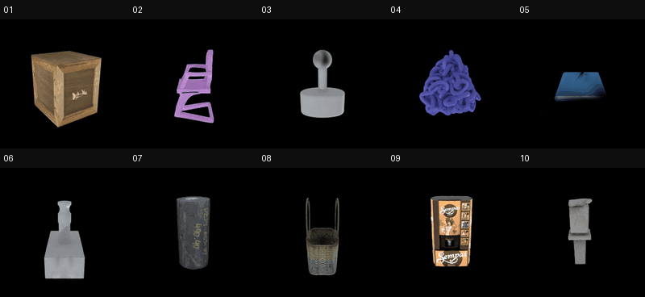

# 3DCV Assignment 2 — Group 7

Repository: [From Images to 3D Gaussians](https://github.com/2331673/From-Images-to-3D-Gaussians-Pipeline-Design-and-Reconstruction-Quality)

A complete image-to-3D Gaussian Splatting pipeline for ten Objaverse objects, with two additional initialization comparisons, analysis code, matching results, trained models, and orbit GIFs. The written report is submitted separately.

- [All ten objects: matches, GIFs, and held-out comparisons](docs/object_index.md)
- [Numerical results](results/metrics.csv) · [Training trajectories](results/summary.json)
- [English project prompts](prompts/README.md)
- [Third-party sources and licenses](THIRD_PARTY_NOTICES.md)



## Pipeline and data

RGBA images and known camera poses → foreground SIFT matching → geometric verification and triangulation → Gaussian initialization → differentiable optimization → held-out evaluation and 96-frame orbit rendering.

The ten objects come from the assets retained in Assignment 1. Each has 30 perspective RGBA images at 256×256 resolution. Views 000, 008, 016, and 024 are held out; 26 views train the model. Camera poses are supplied by Blender. This implementation uses those known poses rather than estimating them with automatic SfM. Gaussian positions and colors are initialized from triangulated image correspondences; objects with fewer than 20 reliable points use 10,000 random points. No source mesh is used for Gaussian initialization.

The main runs and two comparisons use 6,000 steps, seed 42, gsplat v1.5.3, and one H100 80GB. The comparisons for objects 01 and 09 match the initial point counts and vary initial positions and colors.

| Ten-object macro-average | PSNR (dB) ↑ | SSIM ↑ | LPIPS-Alex ↓ | Foreground PSNR (dB) ↑ |
|---|---:|---:|---:|---:|
| 6,000 steps | 35.40 | 0.9823 | 0.0259 | 26.96 |

The first three metrics use floating-point full-image evaluation. Foreground PSNR uses saved 8-bit PNGs with original alpha≥128. The report's background comparison recomputes both regions from the same PNGs. Object 05 accounts for approximately 97.6% of the net PSNR gain from 2,000 to 6,000 steps; the other nine average approximately +0.009 dB.

## Download and unpack the data

Clone or download this repository, then run `python scripts/unpack_artifacts.py` from its root. This verifies SHA256 checksums and extracts the input images, original implementation, upstream dependencies, checkpoints, PLY files, and experiment records. Matching evidence, GIFs, evaluation results, and analysis code are directly browsable before extraction.

## Repository contents

```text
data/raw/<uid>/                 30 RGBA images, camera poses, rendering metadata
data/objects/<uid>/             Prepared RGB/masks, COLMAP files and matching results
manifests/                      Fixed object selection
scripts/                        Portable preparation, training, rendering and analysis
scripts/acp/                    Parameterized cloud execution templates
results/<run_id>/               GIFs, evaluation images, metrics and model checksums
experiments/gsplat_batch_20261104a/  Original 10 primary + 2 comparison runs, including models
experiments/gsplat_v153_smoke*/  Earlier smoke experiments and available logs/artifacts
original_work/                  Original preparation/execution code and intermediate data
third_party/                    Pinned upstream sources and licenses
provenance/                     Runtime and source records; publication manifest
prompts/                        English project prompts documentation
```

`original_work/` preserves the original project's preparation and execution implementation. Local infrastructure paths in archived code and text records are replaced by placeholders; use the portable `scripts/` entry points for reproduction. Binary experimental data, checkpoints, images, and PLY files are preserved byte for byte. Shared upstream source trees appear once in `third_party/`.

The report PDF, personal member information, report-generation scripts, LaTeX sources/templates/fonts, credentials, package caches, and installed dependency environments are excluded. The [publication manifest](provenance/publication_manifest.json) records text sanitization and exclusions. Available failed and preliminary smoke runs are retained as development records, separately from the twelve completed final runs.

## Reproduce the pipeline

The recorded environment is Python 3.10.12, NVIDIA PyTorch 2.3.0a0, torchvision 0.18.0a0, CUDA 12.4, NumPy 1.26.4, and H100 (SM90). See [runtime](provenance/runtime.json) and [environment snapshot](provenance/environment.freeze.txt); the snapshot is informational, not a pip requirements file.

From a compatible PyTorch/CUDA development environment:

```bash
bash scripts/setup_environment.sh
.venv/bin/python scripts/prepare_all.py
bash scripts/run_experiments.sh batch_local
```

Prepared data is included. `prepare_all.py` reconstructs the scenes from the bundled images and poses. The setup script retains the environment's PyTorch/torchvision pairing and compiles the CUDA extensions. LPIPS evaluation requires the pretrained AlexNet weights, downloaded on first use unless already cached.

Render a saved trained model without retraining:

```bash
.venv/bin/python scripts/render_smoke_orbit.py \
  --checkpoint experiments/gsplat_batch_20261104a/09_fdecd4570f78412a821d9c41d98b2cfa/model/ckpts/ckpt_5999_rank0.pt \
  --config experiments/gsplat_batch_20261104a/09_fdecd4570f78412a821d9c41d98b2cfa/model/cfg.yml \
  --output outputs/vending_orbit.gif
```

Inspect `scripts/acp/README.md` for the cloud execution templates; these require your own local resource configuration. The recorded GPU experiments used the original worker. The portable entry points were subsequently adapted and validated for data preparation and command construction.

## Reproduce the analysis

```bash
python -m pip install -r requirements-analysis.txt
python scripts/audit_submission.py
python scripts/analyze_training.py
```

The audit verifies all ten GIFs, training/test isolation, matching tracks, stored metrics, and foreground errors. It exports final track-induced pairwise correspondences to `data/objects/<uid>/matches/retained_correspondences.csv`. These correspondences can be linked through intermediate views; original pairwise candidate counts and matching images are also included.

The training analysis recomputes per-object PSNR changes, Gaussian count ratios, and the contribution of object 05 from saved checkpoint metrics. It writes `results/paper_analysis.json` and does not train a model or generate the report.

For a newly completed batch, collect metrics and artifacts with:

```bash
python scripts/collect_batch_results.py \
  --experiment experiments/batch_local --repository .
```

## Licenses and attribution

Third-party code retains its original licenses; see `THIRD_PARTY_NOTICES.md`. Input images are derived from the selected Objaverse assets. Asset UIDs and available source metadata are preserved in `manifests/` and `data/raw/`; this repository does not grant additional rights to third-party assets.
